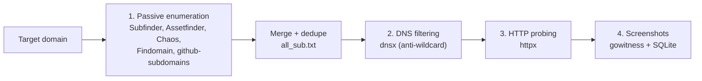

# Asset Discovery Pipeline


Bash pipeline that automates the asset discovery phase of a bug bounty engagement: passive subdomain enumeration, DNS wildcard filtering, HTTP probing, and screenshots stored in SQLite.

> ⚠️ **Authorized targets only.** Use this tool only on assets you have explicit permission to test (bug bounty scope, your own infrastructure). See [Disclaimer](#disclaimer).

## Why this project

Recon is repetitive: run the same tools, merge their outputs, throw away false positives, check what is actually alive. I built this pipeline to chain those steps on a VPS and get a clean, dated folder per target, instead of doing it by hand each time.

## How it works



| Phase | Tools | Output |
|---|---|---|
| 1. Passive enumeration | Subfinder, Assetfinder, Chaos, Findomain, github-subdomains | One file per tool, merged and deduplicated into `all_sub.txt` |
| 2. DNS filtering | dnsx | `clean_sub.txt` (wildcard false positives removed) |
| 3. HTTP probing | httpx (ports 80, 443, 8000, 8080, 8888, 50 threads) | `alive_sub.txt` |
| 4. Screenshots | gowitness (20 threads) | `gowitness.sqlite3`, screenshots, report |

Only phase 1 is passive. Phases 2 to 4 send DNS and HTTP requests to the target, so scope matters.

Design choices:

- **Timeout per tool** (10 minutes): a stuck tool is killed and the pipeline moves on.
- **Errors don't stop the run**: stderr from every tool goes to `erreurs_outils.log`, which is deleted if empty.
- **One folder per target and per day**, so runs never overwrite each other.
- **Input validation**: the domain argument must be a plain hostname, since it is passed to `bash -c`.

## Requirements

- Linux with Bash (tested on an Ubuntu VPS)
- [Go](https://go.dev/doc/install) to install the tools below

```bash
go install github.com/projectdiscovery/subfinder/v2/cmd/subfinder@latest
go install github.com/projectdiscovery/dnsx/cmd/dnsx@latest
go install github.com/projectdiscovery/httpx/cmd/httpx@latest
go install github.com/projectdiscovery/chaos-client/cmd/chaos@latest
go install github.com/tomnomnom/assetfinder@latest
go install github.com/gwen001/github-subdomains@latest
go install github.com/sensepost/gowitness@latest
```

[Findomain](https://github.com/Findomain/Findomain) is distributed as a binary: follow its install instructions.

## Configuration

| Variable | Required | Purpose |
|---|---|---|
| `CHAOS_KEY` | For Chaos | API key for the Chaos dataset |
| `GITHUB_TOKEN` | Optional | Enables github-subdomains (skipped if unset) |
| `BASE_DIR` | Optional | Output root, default `$HOME/bug_bounty/programmes` |

API keys for Subfinder's sources go in its own config file (`~/.config/subfinder/provider-config.yaml`).

**Never commit keys or tokens.** Everything above lives outside this repository.

## Usage

```bash
git clone https://github.com/<your-username>/asset-discovery-pipeline.git
cd asset-discovery-pipeline
chmod +x recon.sh

export CHAOS_KEY="..."
export GITHUB_TOKEN="..."

./recon.sh example.com
```

Output for a run on `example.com`:

```
$BASE_DIR/example/2026-11-15/
├── subfinder.txt
├── assetfinder.txt
├── chaos.txt
├── findomain.txt
├── github.txt
├── all_sub.txt          # merged, deduplicated passive results
├── clean_sub.txt        # after dnsx wildcard filtering
├── alive_sub.txt        # live web services found by httpx
├── gowitness.sqlite3    # screenshots and metadata
└── screenshots/
```


## Author

Mathis Roussé, cybersecurity engineering student at IMT Atlantique.
